# CASE CLOSED — ER Diagram (reconstructed)

The diagram below reflects the tables and declared relationships in the two SQL migrations
recovered from the conversation. It does not add unrecorded entities or columns.

```mermaid
erDiagram
    USERS ||--o{ ROOMS : hosts
    USERS ||--o{ ROOM_PLAYERS : joins
    CASES ||--o{ LOCATIONS : contains
    CASES ||--o{ SUSPECTS : contains
    CASES ||--o{ EVIDENCE : contains
    CASES ||--o{ TASKS : defines
    CASES ||--o{ ROOMS : investigated_in

    LOCATIONS ||--o{ EVIDENCE : contains
    EVIDENCE ||--o{ EVIDENCE_SUSPECTS : linked
    SUSPECTS ||--o{ EVIDENCE_SUSPECTS : linked
    EVIDENCE ||--o{ EVIDENCE_PREREQUISITES : gated_by
    TASKS ||--o{ TASK_PREREQUISITES : gated_by

    SUSPECTS ||--o{ INTERROGATION_DIALOGUES : has
    EVIDENCE o|--o{ INTERROGATION_DIALOGUES : required_for
    INTERROGATION_DIALOGUES ||--o{ INTERROGATION_OPTIONS : source
    INTERROGATION_DIALOGUES o|--o{ INTERROGATION_OPTIONS : next
    EVIDENCE o|--o{ INTERROGATION_OPTIONS : required_for

    TASKS ||--o{ EVIDENCE_TASK_PREREQUISITES : prerequisite
    EVIDENCE ||--o{ EVIDENCE_TASK_PREREQUISITES : gated_by
    INTERROGATION_DIALOGUES ||--o{ EVIDENCE_DIALOGUE_PREREQUISITES : prerequisite
    EVIDENCE ||--o{ EVIDENCE_DIALOGUE_PREREQUISITES : gated_by

    ROOMS ||--o{ ROOM_PLAYERS : contains
    ROOMS ||--o{ ROOM_LOCATION_PROGRESS : tracks
    ROOM_PLAYERS ||--o{ ROOM_LOCATION_PROGRESS : explores
    LOCATIONS ||--o{ ROOM_LOCATION_PROGRESS : visited

    ROOMS ||--o{ ROOM_EVIDENCE : shares
    EVIDENCE ||--o{ ROOM_EVIDENCE : discovered
    ROOM_PLAYERS ||--o{ ROOM_EVIDENCE : discovers

    ROOMS ||--o{ ROOM_TASKS : tracks
    TASKS ||--o{ ROOM_TASKS : progresses
    ROOM_PLAYERS o|--o{ ROOM_TASKS : completes

    ROOMS ||--o{ ROOM_EVENTS : records
    ROOM_PLAYERS o|--o{ ROOM_EVENTS : acts

    ROOMS ||--o{ ROOM_DIALOGUES : shares
    INTERROGATION_DIALOGUES ||--o{ ROOM_DIALOGUES : triggered
    ROOM_PLAYERS ||--o{ ROOM_DIALOGUES : triggers

    ROOMS ||--o| ROOM_VERDICTS : receives
    ROOM_PLAYERS ||--o{ ROOM_VERDICTS : submits
    SUSPECTS ||--o{ ROOM_VERDICTS : selected

    CASES ||--o| CASE_SOLUTIONS : private_solution
    SUSPECTS ||--o{ CASE_SOLUTIONS : correct_suspect

    USERS {
      uuid id PK
      varchar username UK
      varchar email UK
      text password_hash
      timestamptz created_at
      timestamptz updated_at
    }
    CASES {
      uuid id PK
      varchar title
      text description
      varchar difficulty
      varchar status
    }
    LOCATIONS {
      uuid id PK
      uuid case_id FK
      varchar name
      text description
      numeric map_x
      numeric map_y
    }
    SUSPECTS {
      uuid id PK
      uuid case_id FK
      varchar name
      varchar role
      text biography
      text profile_image_url
    }
    EVIDENCE {
      uuid id PK
      uuid case_id FK
      uuid location_id FK
      varchar title
      text description
      varchar evidence_type
      boolean is_hidden
      text discovery_hint
    }
    TASKS {
      uuid id PK
      uuid case_id FK
      varchar title
      text description
      integer sort_order
      boolean is_required
    }
    ROOMS {
      uuid id PK
      varchar room_code UK
      uuid case_id FK
      uuid host_user_id FK
      varchar status
      integer max_players
    }
    ROOM_PLAYERS {
      uuid id PK
      uuid room_id FK
      uuid user_id FK
      uuid case_id FK
      varchar player_role
      varchar status
      uuid current_location_id FK
      timestamptz joined_at
      timestamptz last_seen_at
      timestamptz left_at
    }
    ROOM_EVENTS {
      uuid id PK
      uuid room_id FK
      uuid actor_room_player_id FK
      varchar event_type
      jsonb payload
      timestamptz created_at
    }
    ROOM_VERDICTS {
      uuid id PK
      uuid room_id FK
      uuid case_id FK
      uuid submitted_by_player_id FK
      uuid selected_suspect_id FK
      text explanation
      boolean is_correct
      text evaluation_feedback
    }
    CASE_SOLUTIONS {
      uuid case_id PK,FK
      uuid correct_suspect_id FK
      text solution_explanation
      jsonb solution_data
    }
```

## Notes

- `CASE_SOLUTIONS` is in the `private` schema, not `public`.
- Composite foreign keys enforce case consistency in several junction/progress tables.
- The diagram is logical; the exact SQL files are authoritative for nullability, uniqueness and checks.
- `ROOM_PLAYERS.current_location_id` is made case-consistent by Migration 2 through `(case_id, current_location_id)`.
